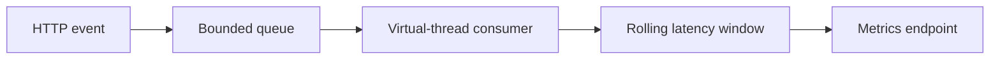

# Architecture and engineering decisions

> **Scope:** a local reference implementation using invented/synthetic inputs. No production deployment or service-level claims are implied.

## Java bounded telemetry under overload

**Actual processing path:** HTTP ingest --> Validated event --> ArrayBlockingQueue --> Virtual-thread consumer --> Rolling latency samples --> HTTP metrics; queue full returns 429.

## Key files

- `src/main/java/dev/swaraj/tracecraft/TelemetryPipeline.java`: bounded ingestion, aggregation and metric snapshots.
- `src/main/java/dev/swaraj/tracecraft/Server.java`: lightweight HTTP service.
- `src/test/java/dev/swaraj/tracecraft/SmokeTest.java`: pipeline/API smoke tests.

## Failure modes / trust boundaries

In-memory metrics are not durable, quantiles reflect only the bounded sample, and intentional 429 overload rejection loses incoming telemetry. No sensitive payloads should be sent.

## What I would build next

OpenTelemetry exporter, histogram strategy, metric cardinality limits, sustained load tests.

## Reviewer checklist

1. Read the source and confirm the processing path above.
2. Follow `docs/DEMO.md` and run the tests locally.
3. Inspect CI and document any divergence between local and GitHub results.
4. Treat all benchmarks as synthetic demonstrations unless proven otherwise.
